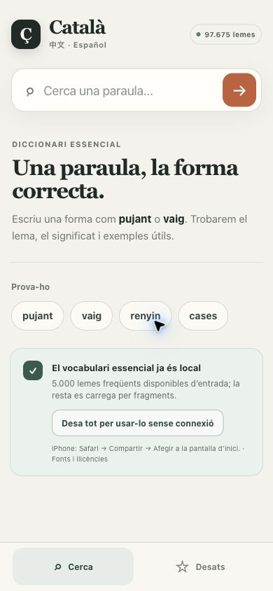
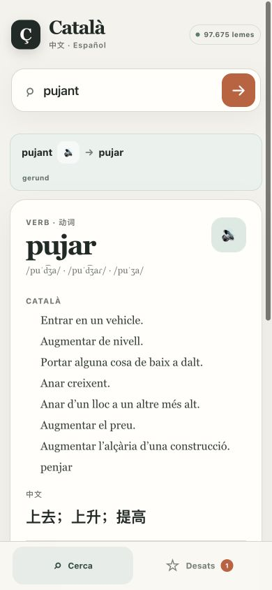
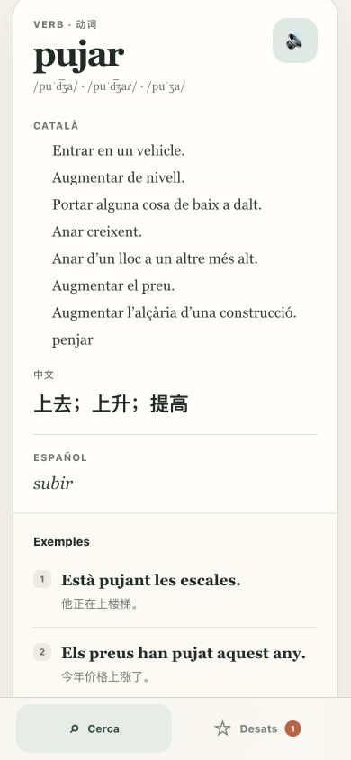
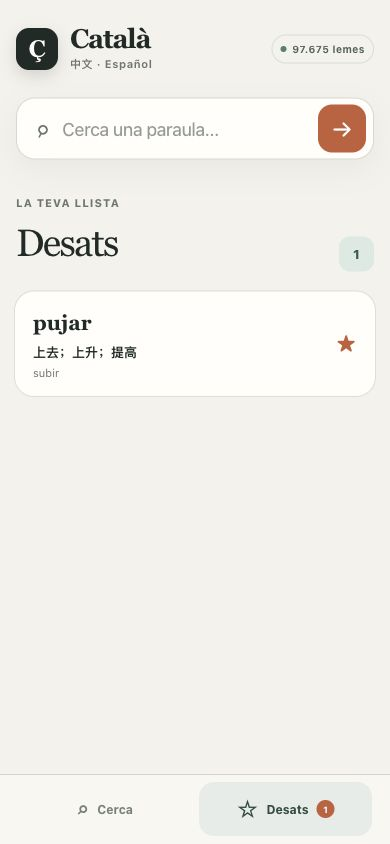
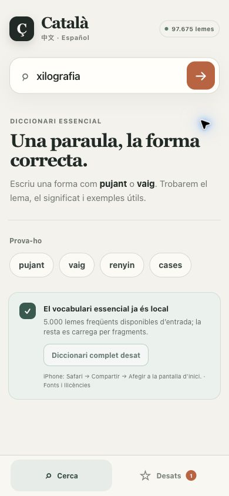

# Català — 随身字典

[English](README.md) · 中文 · [Español](README.es.md)

笨人来巴塞罗那留学，但是 Català 水平很烂，遂做了个加泰罗尼亚语／中文／西班牙语
三语对照字典，方便自己查词。欢迎大家取用！

支持中文、西语、加泰语查词，以及词形查询、发音、收藏和离线使用，手机上也能安装。
约有 9.7 万个加泰语词条；中文释义仍在分批补充，机器辅助译文会单独标明。

以下说明对应当前仓库代码版本，新增功能须部署后才会在线上生效。
文中的截图来自旧版本，仅作为页面布局和使用流程的示例。

## 打开和查词

[打开字典](https://catalan-dictionary-pwa.vercel.app)，直接在浏览器里使用，无需注册或登录。



*首页：上方查词，下方的 Cerca 是搜索页，Desats 是收藏页。*

1. 在同一个搜索框输入**中文、西语或加泰语单词或短语**。默认「自动」搜索，
   也可以选择「中文／Español／Català」限定输入语言。
2. 按 **Enter** 或点击右侧 **→**。例如 `学校`、`學校`、`escuela` 和 `escola`
   都可以找到 `escola`；输入加泰语词形 `pujant` 仍会找到原形 `pujar`。
3. 查看已有的释义、词形信息和例句。反查结果会注明命中语言和对应译词。
   如果同一拼写同时存在于西语和加泰语，或查询有多个词义，可以在「其他 Català 候选」中选择。




*词形查询示例：pujant → pujar。向下滚动可看翻译、例句和收藏按钮。*

中文反查支持简体和繁体。反查依赖目前已有的译词和检索词，缺少释义时也可能缺少反查结果。
中文和西语支持输入联想、部分译词匹配和近似拼写建议。输入中文至少一个字、
西语至少两个字母后，搜索框下方会显示译词及对应 Català 单词；点击选择，
或用上下方向键选择后按 Enter，按 Esc 收起。没有完整匹配时也会显示建议，
不会自动把拼写近似词当作精确结果。中文输入法组词期间不会提前查词。
完整离线词库包含全部联想数据；仅下载常用词库时，离线建议限于常用词。
中文匹配会合并简繁重复项，支持简繁混写、汉字间误加空格和问号、引号等外层符号。
常用说法如「你好、公交车、牛奶、电话、西班牙语」会优先显示经过原词义比对的词条。
也补充了「你、他、她、公交站、鸡蛋、猪肉、起床」等说法；「起床」的释义注明 `llevar-se` 的自反用法。
常见地区说法也可查，例如「的士／计程车、单车／脚踏车、软体／软件、芝士／起司、马铃薯／土豆」。
近似拼写建议保留开头的否定词和数量，不会把「不可以」改成「可以」或把「二月」改成「三月」。
也可输入「学校用加泰语怎么说」「请问公交车的加泰语是什么」等明确的查词提问，
结果会标明提取的检索词；普通句子和询问其他目标语言的句子不会被拆词翻译。
常见同音错字优先提示，例如 `学小 → 学校`、`敢冒 → 感冒`；仍需选择确认。
多音字会参考词语读音，例如 `银航 → 银行`、`音悦 → 音乐`。
`学校的` 可提示词头 `学校`，简短译词优先于长句释义，已有精确译词始终优先。
也补充了根据现有词义核对的日常检索说法，例如 `吃饭 → menjar`、`早安 → bon dia`、
`晚安 → bona nit`、`火车站 → estació de tren`。匹配属于词典检索，不提供整句翻译。
这是单词和短语字典，不提供整句翻译。不是每个词都有完整三语释义、音标和例句；
有些词只有加泰语或英语释义。「机器辅助」标记按原词义资料生成的中文译文，
没有依据的中文释义会继续留待补充。
「词库参考」表示来自开放双语词库的对应词，已核对原词、词性和词义编号，
但可能仅涵盖部分词义。现有 97,675 个词条中，97,668 个已包含中文释义或译词参考，
常用核心词库的 5,005 个词条全部覆盖。新增批量释义保留「机器辅助」标记；
只有词头资料的条目另标「译词参考」，尚未逐词人工审校。
剩余 7 个原始条目缺乏可靠释义依据，明确列入来源问题清单，没有用占位文字充数。

尽量保留重音符号。比如 `coneixer` 会提示 `conèixer`，点击建议再查看。
找不到词时，可以检查拼写、重音，或试试单词原形。

## 发音、收藏和历史

- 点击 **🔊**，使用设备或浏览器提供的语音朗读。必要时在设备的语音设置中下载加泰语声音；发音质量和离线朗读能力因设备而异。
- 发音按钮朗读查到的加泰语词条，中文、西语原输入不会被当成加泰语朗读。
- 词库更新后，收藏会在打开时更新对应词条，保留收藏时间和顺序；下载失败时仍保留原有内容。
- 在词条上点击 **☆ Desa** 收藏，按钮会变成 **★ Desat**。
- 点击底部 **Desats** 查看收藏；点击词条重新查词，点击星号移除收藏。
- 点击 **Cerca** 返回首页；**Recent** 是最近成功查过的词，点击时沿用原来的输入语言；**Esborra** 只清空查词历史，不删除收藏。收藏词条会直接使用 Català 模式打开。



*收藏保存在当前设备的当前浏览器里。*

没有账号同步或内置导出功能。清除网站数据可能删除收藏、历史和已下载词库；
隐私模式也可能阻止保存。**收藏一个词不等于下载完整离线词库**，点击收藏仍会重新查词。

## 准备离线使用

首次打开时先保持联网，等待初始准备完成。常用的约 5,000 个词条及其已有中文释义、
反查数据会自动保存在本地，其他词条在联网查询时按需加载。
要离线使用完整词库：

1. 在页面内容下方找到「下载完整离线词库」。查看历史、搜索结果或收藏时都保留下载入口，无需清空历史。
2. 点击下载，保持页面打开。压缩词库与检索数据合计约 **31 MB**，按钮会显示当前版本的实际体积，还需要给应用和浏览器存储留一些额外空间。
3. 等按钮变成「完整词库已保存 · Diccionari complet desat」后，再断网使用。
4. 如果下载中断，恢复联网后重新点击下载，会接着处理还没保存的部分。



*看到“Diccionari complet desat”，表示完整词库下载完成。*

离线使用需要在**同一个浏览器**里先准备好应用和词库。浏览器可能清理本地存储，
出门前最好检查一次。词库版本更新后，先联网打开，再重新下载新版本。
离线查询需要尚未下载的数据时，应用会提示本地词库可能不完整；联网或下载完整词库后再试。

## 安装到手机或电脑

- **iPhone / iPad：** Safari → 分享 → 添加到主屏幕 → 添加。如果出现“作为网页 App 打开”开关，保持开启。
- **Android Chrome：** 地址栏旁的菜单 → 安装和创建快捷方式 → 安装，跟随提示操作。
- **电脑 Chrome：** 点击地址栏的安装图标，或在菜单的“投放、保存和分享”里寻找“将网页安装为应用”。其他浏览器的入口可能不同。

菜单名称和是否显示安装入口，取决于系统与浏览器版本。安装是可选的，
**安装应用不会自动下载完整离线词库**。
也可参考官方的 [Apple 安装说明](https://support.apple.com/guide/iphone/iphea86e5236/ios)、
[Android Chrome 说明](https://support.google.com/chrome/answer/9658361?co=GENIE.Platform%3DAndroid&hl=zh-Hans)
和[电脑 Chrome 说明](https://support.google.com/chrome/answer/9658361?co=GENIE.Platform%3DDesktop&hl=zh-Hans)。

## 常见问题

使用较新的浏览器。词条加载失败时，恢复联网并刷新；没有结果时，检查拼写或改查原形。
收藏或下载失败时，检查剩余空间，并避免使用隐私模式。没有声音时，检查设备安装的语音。

仍有问题可[提交 Issue](https://github.com/easonlines2007/catalan-dictionary/issues)，说明设备、浏览器和查的词，避免附上个人信息。

## 本地运行

使用 **Node.js 22**：

```bash
git clone https://github.com/easonlines2007/catalan-dictionary.git
cd catalan-dictionary
npm ci
npm run dev
```

打开 [localhost:3000](http://localhost:3000)。要测试生产模式，先停止开发服务器，
执行 `npm run build`，再运行 `npm start`。页面离线缓存在生产模式启用，断网刷新应在这个模式下测试。

验证：`npm test`、`npm run lint`、`npm run typecheck`。

应用代码采用 [MIT 许可](LICENSE)，词典数据保留各自的原许可：
[来源与署名](DATA_SOURCES.md)。[隐私说明](PRIVACY.md)。
